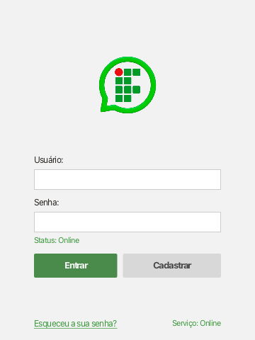
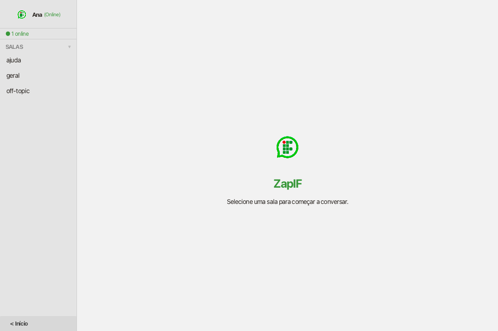
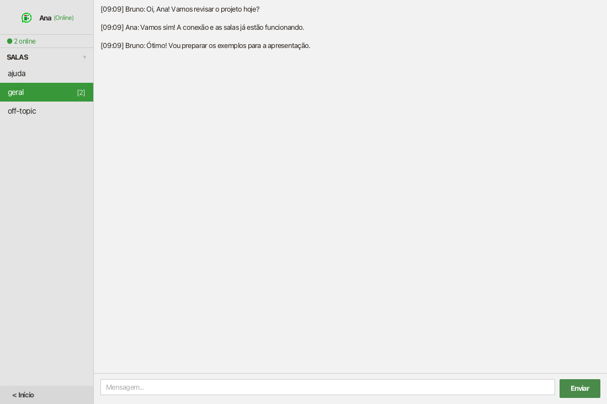

# ZapIF — Real-Time Chat with JavaFX + Sockets

> Project built for the **Programming Language 1** course.
> The goal is to explore, hands-on, how **threads**, **TCP socket connections** and **JavaFX user interfaces** work, bringing these concepts together in a complete client-server chat application.

Client-server chat system over TCP. The server runs as a single process and clients connect through a JavaFX desktop app.

```
Client A ──── TCP ───► Server (port 5001) ◄──── TCP ──── Client B
```

---

## Screenshots

| Login | Home | Chat Room |
|:---:|:---:|:---:|
|  |  |  |

---

## Structure

```
ZapIF/
├── pom.xml          # aggregator pom (server and client modules)
├── mvnw, mvnw.cmd   # Maven Wrapper — no need to have Maven installed
├── .mvn/wrapper/
│
├── server/          # Server (plain Java + SQLite)
│   ├── pom.xml
│   └── src/main/java/server/
│       ├── Servidor.java            # entry point — ServerSocket + thread pool
│       ├── ManipuladorCliente.java  # one thread per client, parses the protocol
│       ├── RegistroSessao.java      # online users (prevents duplicate login)
│       ├── Sala.java                # groups clients, broadcasts messages
│       └── BancoDados.java          # SQLite: users, rooms, messages
│
├── client/          # Client (JavaFX 21)
│   ├── pom.xml
│   └── src/main/
│       ├── java/
│       │   ├── module-info.java
│       │   └── client/
│       │       ├── Main.java                          # JavaFX entry point
│       │       ├── network/Conexao.java               # socket + automatic retry
│       │       ├── network/OuvinteMensagem.java       # message listener
│       │       ├── network/OuvinteStatusConexao.java  # connection status listener
│       │       ├── ui/ControladorLogin.java           # login/sign-up screen
│       │       ├── ui/ControladorChat.java            # main chat screen
│       │       └── model/{Usuario,Mensagem}.java
│       └── resources/client/
│           ├── icon.png
│           └── ui/
│               ├── login.fxml
│               ├── chat.fxml
│               └── style.css
│
├── docs/screenshots/  # images used in this README
└── uml/               # diagrams (Astah + PlantUML) and scope
```

---

## Prerequisites

| Tool | Minimum version | How to check |
|---|---|---|
| JDK | 17 | `java -version` |
| Maven | 3.8 (optional) | `mvn -version` |

The project ships with the **Maven Wrapper** (`./mvnw` on Linux/Mac, `mvnw.cmd` on Windows), which downloads Maven 3.9.6 on first run. If you'd rather use an installed Maven, replace `./mvnw` with `mvn` in the commands below. All commands run **from the repository root**.

> **Windows**: make sure `JAVA_HOME` points to JDK 17+ and that `%JAVA_HOME%\bin` is on your `PATH`. Use `mvnw.cmd` instead of `./mvnw`.

---

## Getting Started

### Step 1 — Build and start the server

Open a terminal at the project root:

```bash
./mvnw package          # builds server and client
java -jar server/target/zapif-server-1.0-SNAPSHOT.jar
```

Expected output:
```
Banco de dados pronto.
Servidor iniciado na porta 5001 (max 100 clientes)
```

> Three `SLF4J: ...` warnings from the SQLite driver may show up before these lines — they're harmless.

The `chat.db` file (SQLite) is created automatically in the current directory. Keep this terminal open — the server needs to keep running. Press `Ctrl+C` to stop it.

### Step 2 — Start the client

Open **another** terminal, also at the project root:

```bash
./mvnw -pl client javafx:run
```

The login window opens. Click **Cadastrar** (Sign up) to create an account, then **Entrar** (Log in).

> To open multiple clients (to simulate a conversation), run `./mvnw -pl client javafx:run` again in additional terminals.

### Connecting two computers on the same network

By default the client connects to `localhost:5001`. Pointing it at another computer **doesn't require recompiling**:

1. Find the local IP of the computer running the server:
   - Windows: `ipconfig` → "IPv4 Address"
   - Linux/Mac: `ip a` or `ifconfig`
2. On the other computers, start the client passing the IP:
   ```bash
   ./mvnw -pl client javafx:run -Dzapif.host=192.168.0.10
   ```
   Or use environment variables:
   ```bash
   ZAPIF_HOST=192.168.0.10 ./mvnw -pl client javafx:run       # Linux/Mac
   ```
   ```powershell
   $env:ZAPIF_HOST="192.168.0.10"; .\mvnw.cmd -pl client javafx:run   # Windows (PowerShell)
   ```
3. Allow port 5001 (TCP) through the firewall on the server machine.

| Setting | Property (`-D`) | Environment variable | Default |
|---|---|---|---|
| Server host | `zapif.host` | `ZAPIF_HOST` | `localhost` |
| Server port | `zapif.port` | `ZAPIF_PORT` | `5001` |

The `-D` property takes precedence over the environment variable. Outside Maven (e.g. the image built by `jlink`), pass the property straight to the JVM: `client/target/image/bin/java -Dzapif.host=192.168.0.10 -m client/client.Main`.

> The **server** port is fixed in `Servidor.PORTA` (5001); `zapif.port` only changes where the client connects.

---

## Troubleshooting

| Symptom | Likely cause | Fix |
|---|---|---|
| `Unable to access jarfile server/target/...` | Maven didn't build it | Run `./mvnw package` before `java -jar` |
| "Sem conexão — reconectando..." / "Serviço: sem conexão" banner | Server isn't running or wrong host | Start the server first (Step 1) and check `zapif.host` |
| `Erro fatal no servidor: Address already in use` | Another process is using port 5001 | `netstat -ano \| findstr :5001` (Windows) or `lsof -i :5001` (Linux/Mac) and kill the process |
| `UnsatisfiedLinkError` / `JavaFX runtime components are missing` | JRE without JavaFX | Use JDK 17+ and run via `./mvnw -pl client javafx:run`, not `java -jar` |
| Login hangs for 10 s | Server isn't responding | Check that the server is up and reachable |
| `Usuário já está conectado em outra sessão` | Same user logged in on another client | Close the other session or use a different user |

---

## Message Protocol

Plain text, one message per line, fields separated by `|`. Lines longer than 4096 characters are rejected. Usernames containing `|` are rejected; in room names and message text the `|` is stripped.

| Message | Direction | Description |
|---|---|---|
| `REGISTER\|name\|password` | client → server | Sign up |
| `LOGIN\|name\|password` | client → server | Authenticate |
| `JOIN\|room` | client → server | Join a room (leaves the previous one, if any) |
| `LEAVE\|room` | client → server | Leave the current room (back to the home screen) |
| `MSG\|room\|name\|text` | both | Send/receive a message — the server uses the authenticated username, not the one sent |
| `PONG` | client → server | Reply to `PING` |
| `ROOMS\|room1,room2,...` | server → client | Room list after login |
| `ONLINE\|total\|room1:n,room2:n,...` | server → client | Online users and per-room count (sent to that client after login, and broadcast on every join/leave/disconnect) |
| `HISTORY\|room\|msg1\|msg2\|...` | server → client | Last 50 messages when joining a room (`[HH:mm] name: text`, with date separators) |
| `PING` | server → client | Heartbeat every 20 s after login |
| `OK\|context` | server → client | Acknowledgement (`OK\|REGISTER`, `OK\|LOGIN`) |
| `ERROR\|reason` | server → client | Descriptive error |

Join/leave notices (`[nome entrou]`, `[nome saiu]`, `[nome desconectou]`) are sent as free-form text lines to the other members of the room. The current client ignores these lines.

The server closes the connection if it receives nothing for 45 s (the client automatically answers `PING` with `PONG`).

### Validated limits

| Field | Limit |
|---|---|
| Username | 3–24 characters, no `\|` |
| Password | 6–64 characters |
| Message text | 1–500 characters (excess is truncated), `\|` stripped |
| Room name | up to 64 characters, `\|` stripped; must exist in the database |

---

## Database (SQLite)

Tables are created automatically on first run:

```sql
usuarios  (id, nome UNIQUE, senha_hash, salt)
salas     (id, nome UNIQUE)
mensagens (id, sala_nome, usuario, texto, timestamp)
```

Passwords are stored with **PBKDF2-HMAC-SHA256** + a random per-user salt (100,000 iterations).

---

## Client Architecture

```
JavaFX thread (UI)              "chat-connect" thread (daemon)
├── ControladorLogin            ├── Socket.connect()
├── ControladorChat             ├── readLine() loop
└── reacts to Platform.runLater() └── Platform.runLater() → notifies listeners
```

### Connection states

```
CONECTANDO → CONECTADO → (drop) → DESCONECTADO → retry 5s → CONECTANDO ...
```

The red "Sem conexão — reconectando..." banner appears in `DESCONECTADO` and disappears once reconnected.

---

## Packaging for Distribution

### Server (fat jar)

```bash
./mvnw -pl server package
# produces: server/target/zapif-server-1.0-SNAPSHOT.jar (with the SQLite driver bundled)
java -jar server/target/zapif-server-1.0-SNAPSHOT.jar
```

### Client (native installer)

```bash
./mvnw -pl client package javafx:jlink   # builds a runtime image in client/target/image
client/target/image/bin/java -m client/client.Main   # test the image

# installer (run on the target OS; --type: exe/msi on Windows, dmg/pkg on Mac, deb/rpm on Linux)
jpackage --runtime-image client/target/image --module client/client.Main \
         --name ZapIF --dest client/target/dist --type exe
```

---

## Default Rooms

Created automatically if they don't exist:

- `geral`
- `off-topic`
- `ajuda`

---

## Design Decisions

| Decision | Rationale |
|---|---|
| Thread-per-client on the server | simple, no external framework |
| ExecutorService (pool of 100) | avoids unbounded thread creation under load |
| CopyOnWriteArrayList for room clients | frequent reads, rare writes |
| PBKDF2 + salt for hashing | resists rainbow tables with no extra dependency |
| Platform.runLater() centralized in Conexao | controllers don't need to know about threading |
| Limited split in the parser (`split("\\|", 4)`) | the text field can contain `\|` without breaking parsing |
