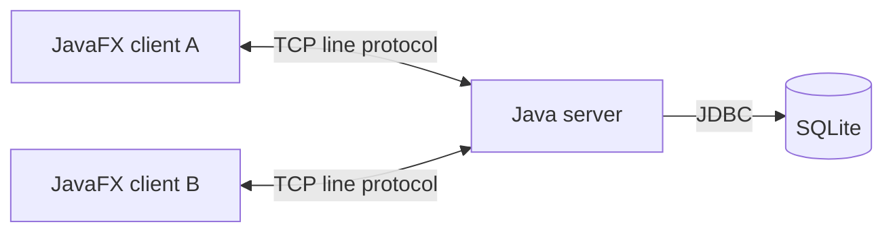

# ZapIF — Java desktop chat over TCP

A client/server chat application where people connect from a JavaFX desktop
client, join a room and exchange messages through a plain Java TCP server.

**Status:** Academic project · Programming Language 1.

[](https://github.com/ErickHTF/ZapIF/actions/workflows/ci.yml)

[Run locally](#run-locally) · [Development guide](docs/development.md) ·
[Architecture](docs/architecture.md) · [TCP protocol](docs/protocol.md)

| Login                                              | Room list                                                               | Live chat                                                               |
| -------------------------------------------------- | ----------------------------------------------------------------------- | ----------------------------------------------------------------------- |
|  |  |  |

_The interface is in Portuguese. Screenshots show two clients exchanging messages over the running local server._

## Overview

ZapIF explores socket communication, server concurrency and desktop UI
programming through a small chat application.

- Register an account and sign in from the JavaFX client.
- Join the default `geral`, `off-topic` and `ajuda` rooms.
- Exchange messages and view recent room history.
- See online users and room activity.
- Reconnect automatically if the server connection drops.

## Stack

| Layer               | Technologies                                       |
| ------------------- | -------------------------------------------------- |
| Desktop client      | Java 17, JavaFX 21, FXML                           |
| Chat server         | Java 17, TCP sockets, bounded executor             |
| Storage             | SQLite                                             |
| Build and packaging | Maven Wrapper, JavaFX Maven plugin, jlink/jpackage |
| Verification        | Maven build, GitHub Actions                        |

## Run locally

Install **JDK 17+**. Maven comes through the included wrapper.

```bash
git clone https://github.com/ErickHTF/ZapIF.git
cd ZapIF
./mvnw package
```

Start the server in one terminal:

```bash
java -jar server/target/zapif-server-1.0-SNAPSHOT.jar
```

Start the JavaFX client in another terminal:

```bash
./mvnw -pl client javafx:run
```

Register an account in the client, then sign in and choose a room. Open another
client to try a conversation. The server creates `chat.db` in its current
working directory. See the [development guide](docs/development.md) for network
configuration, packaging and troubleshooting.

## Verification

```bash
./mvnw verify
```

The project builds three Maven modules: the root aggregator, TCP server and
JavaFX client. The repository currently has no automated test sources.

## Architecture



Each client has a socket connection handled by the server's executor. The server
authenticates users, tracks active rooms and broadcasts messages to room members.
The client reads socket events off the JavaFX thread and dispatches UI updates
through `Platform.runLater`.

See the [architecture guide](docs/architecture.md) for client connection states
and implementation decisions. The [protocol guide](docs/protocol.md) documents
message framing and local storage.

## Documentation

| Guide                                        | Contents                                                      |
| -------------------------------------------- | ------------------------------------------------------------- |
| [Development](docs/development.md)           | Build, run, host configuration, packaging and troubleshooting |
| [Architecture](docs/architecture.md)         | Client/server flow and design decisions                       |
| [TCP protocol and storage](docs/protocol.md) | Message types, field limits and SQLite schema                 |
| [UML diagrams](uml/)                         | Scope, use cases, packages and sequence diagrams              |

## Project context

Developed for the Programming Language 1 course. The project focuses on learning
how TCP sockets, concurrent clients and JavaFX interfaces work together.

No license is currently included in this repository.
